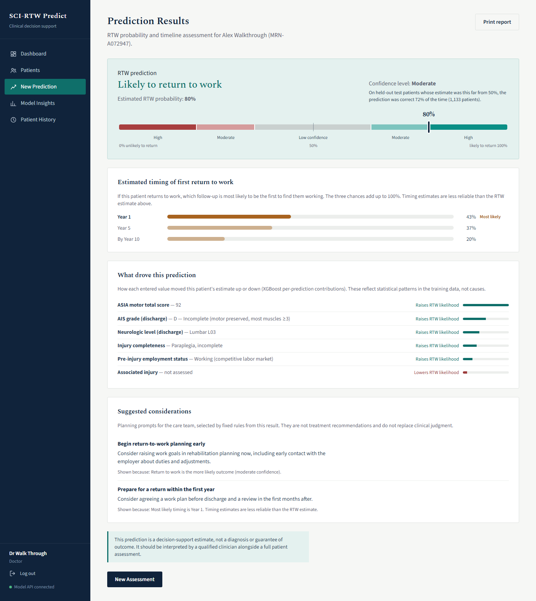

# SCI-RTW Predict

A clinical decision-support prototype that estimates whether a person with
a spinal cord injury will return to work within ten years, and roughly
when. Final-year project (CSP600, UiTM): "Predicting Return to Work
Following Spinal Cord Injury Using Machine Learning Algorithms".



## What it does

- A clinician enters a patient's demographics, injury profile and motor
  score, and gets the probability of return to work, a confidence level,
  the likely timing, the factors behind the estimate and planning prompts.
  The result can be printed as a report.
- Every prediction is saved to the patient's history in a database, with
  login and separate roles for doctors, therapists, patients and an
  administrator.
- A Model Insights screen shows how the three algorithms compare and how
  far the estimates can be trusted.

## How well it works

Trained on 16,841 patients from the U.S. NSCISC public dataset, tested on
a held-out 20%.

| | XGBoost (deployed) | Random Forest | Logistic Regression | Always guess the majority |
|---|---|---|---|---|
| Return to work, yes or no: accuracy | 67.6% | 67.1% | 67.3% | 53.9% |
| Return to work, yes or no: ROC-AUC | 0.744 | 0.740 | 0.741 | 0.5 |
| Timing (Year 1 / 5 / 10): accuracy | 54.1% | 55.8% | 52.9% | 59.2% |

- All three algorithms clearly beat guessing on the yes/no question and
  are within one point of each other, with no significant difference.
- Predictions far from 50% are much more reliable: 88% correct at the
  "High" confidence level against 57% at "Low".
- **Uneven across groups.** Accuracy is similar for every group checked,
  but the kind of error is not. The model leans heavily on education: of
  the patients without a high school diploma who did return to work it
  identified 16%, and of those with a degree who did not, also 16%.
- **Timing is weak.** No model beats always answering "Year 1" on
  accuracy; the deployed model is weighted to recognise the later classes
  instead. Treat timing as indicative only.
- **U.S. data only.** The model has not been validated on Malaysian
  patients, whose job market, welfare support and education system differ.

Full results, and every problem found and fixed along the way, are in
[`docs/test_report.md`](docs/test_report.md). Figures are in
`docs/figures/`, screenshots of every screen in `docs/screenshots/`.

## Quick start

```bash
pip install -r requirements.txt
cd api && python -m uvicorn main:app --reload --port 8000     # terminal 1
cd frontend && npm install && npm run dev                     # terminal 2
```

Open `http://localhost:5173` and sign in as `admin` / `admin123`. That is
a demonstration default, and the system asks you to replace it before it
lets you do anything else. The rest of this file is the detailed setup and
demo guide.

---

## 1. Install dependencies

```bash
pip install -r requirements.txt
```

## 2. Folder structure

```
sci_rtw/
├── requirements.txt
├── Dockerfile, render.yaml   <- hosting (section 8)
├── NSCISC_Public_Data_2021/  <- raw NSCISC files (only needed to retrain)
├── api/
│   ├── main.py               <- prediction, patient profiles, history
│   ├── auth.py               <- login, roles, user accounts, sign-in lockout, audit log
│   ├── recommendations.py    <- confidence level + suggested considerations
│   ├── db.py                 <- SQLite schema (the ERD)
│   ├── seed_demo_data.py     <- optional: fill the database with demo records
│   └── sci_rtw.db            <- created automatically on first run
├── models/                   <- generated by train_models.py
│   ├── layer{1,2}_xgboost.json, layer{1,2}_preprocessor.joblib
│   ├── layer{1,2}_random_forest.joblib, layer{1,2}_logistic_regression.joblib
│   ├── layer2_label_encoder.joblib
│   ├── layer{1,2}_results.json     <- test metrics (Table 3.17)
│   ├── evaluation_report.json      <- cross-validation, overfitting check, etc.
│   ├── imputation_modes.json, category_options.json
├── processed/                <- generated by data_pipeline.py
├── src/
│   ├── data_pipeline.py
│   ├── train_models.py
│   ├── make_figures.py       <- report figures -> docs/figures/
│   ├── evaluate_subgroups.py <- accuracy by sex, age, education, injury, race
│   ├── experiment_splits.py  <- split ratio, fold count, significance tests
│   ├── experiment_fim.py     <- evidence for leaving FIM out of the model
│   ├── experiment_motor_score.py  <- how a missing motor score should be filled
│   └── measure_performance.py     <- API response times (performance requirement)
├── docs/                     <- test report, figures, screenshots, usability test kit
├── tests/
└── frontend/
```

### Retraining (optional; trained models are already in `models/`)

The NSCISC data is not in this repository: the raw files come from NSCISC,
and `processed/` holds patient-level rows derived from them. Put the raw
CSVs in `NSCISC_Public_Data_2021/` and run the pipeline first to create
`processed/`. Everything else, including the API, the frontend and the
tests, works without it; the two tests that need it are skipped.

```bash
python src/data_pipeline.py    # raw NSCISC CSVs -> processed/
python src/train_models.py     # tuning + 5-fold CV + test evaluation, about 5 minutes
python src/make_figures.py     # ROC, confusion matrices, calibration, factor importance
python src/evaluate_subgroups.py   # accuracy for each group of test patients
python src/measure_performance.py  # response times, on a throwaway database
```

`models/imputation_modes.json` and `models/category_options.json` are
copies the API reads at startup: the first is written to `processed/` by
the pipeline, the second lists every category value in the processed data.
Neither changes unless the predictor fields or the cohort change.

## 3. Run the API

```bash
cd api
uvicorn main:app --reload --port 8000
```

You should see:
```
INFO:     Application startup complete.
INFO:     Uvicorn running on http://0.0.0.0:8000
```

Leave this terminal running during your demo.

## 4. Test it's working

Open a **second terminal** (or use your browser / Postman):

```bash
# Health check
curl http://localhost:8000/health

# Interactive API docs (open in browser) - great for a live demo
open http://localhost:8000/docs
```

FastAPI auto-generates a `/docs` page (Swagger UI) where you can fill in a
patient form and hit "Execute" right in the browser — this alone can serve
as a demo if the frontend isn't ready yet.

### Logging in

On first run the API creates the database and one administrator:

| Username | Password |
|---|---|
| `admin` | `admin123` |

**This default is for demonstration only.** The first time you sign in
with it, the system shows a "Choose a new password" screen and nothing
else works until you have changed it. To start with a password of your own
instead, set the `SCI_RTW_ADMIN_PASSWORD` environment variable before the
very first run.

Five wrong passwords in a row lock sign-in for that username for fifteen
minutes.

For a demo you also need a clinician: either register as a Doctor on the
sign-in screen and approve the account as `admin`, or create one directly
from User Accounts.

### Example prediction request

Every endpoint except `/health`, `/category-options` and `/auth/*` needs a
login token:

```bash
TOKEN=$(curl -s -X POST http://localhost:8000/auth/login \
  -H "Content-Type: application/json" \
  -d '{"username": "your_doctor", "password": "your_password"}' \
  | python -c "import sys, json; print(json.load(sys.stdin)['token'])")

curl -X POST http://localhost:8000/predict \
  -H "Content-Type: application/json" -H "Authorization: Bearer $TOKEN" \
  -d '{
    "sex": "1.0",
    "age_at_injury": 28,
    "education_level": "3.0",
    "marital_status": "1.0",
    "pre_injury_employment_status": "1.0",
    "injury_cause": "1.0",
    "neuro_level_discharge": "L01",
    "aisgrade_discharge": "D",
    "injury_completeness_discharge": "2.0",
    "asia_motor_total_discharge": 85
  }'
```

Expected: a JSON response with `rtw_status`, `rtw_probability`,
`rtw_timing` (if RTW predicted), `top_factors`, `patient_factors`,
`confidence` and `recommendations`.

### Demo data (optional)

```bash
python api/seed_demo_data.py
```

Adds six demo accounts (password `demo12345`), twelve invented patient
profiles and fifteen saved predictions. It only adds records and refuses
to run twice. The clinical inputs are rows of the held-out test split, so
it needs `processed/` (see "Retraining").

## 5. Endpoints available

| Method | Path | Who | Purpose |
|---|---|---|---|
| GET | `/health` | anyone | Confirms models are loaded; gives the version of the deployed models |
| GET | `/category-options` | anyone | Valid dropdown values for every categorical input field |
| POST | `/auth/register`, `/auth/login`, `/auth/logout` | anyone | Register and login (FR1) |
| GET | `/auth/me` | logged in | Current user and role |
| POST | `/auth/change-password` | logged in | Change own password |
| GET | `/model-info` | clinician, admin | Metrics, validation and factor importance (Model Insights screen) |
| POST | `/predict` | clinician | Runs Layer 1 + Layer 2; result is not saved |
| GET, POST | `/patients` | clinician | List and create patient profiles (FR2) |
| GET, PUT, DELETE | `/patients/{id}` | clinician | View, update, remove a patient profile |
| POST | `/patients/{id}/predictions` | clinician | Run a prediction and save it to that patient's history |
| GET | `/predictions` | clinician, patient | Prediction history (FR7); a patient sees only their own. Optional `limit` (1–500) and `offset` page through it; `X-Total-Count` gives the total |
| PATCH | `/predictions/{id}/notes` | clinician | Clinician notes on a saved prediction |
| GET, POST | `/users` | admin | List and create user accounts |
| PATCH, DELETE | `/users/{id}` | admin | Approve, edit, deactivate, remove an account |
| GET | `/audit-log` | admin | Who signed in, and who created, changed or removed which account or patient record |

"Clinician" means the doctor and therapist roles.

## 6. Troubleshooting

- **`ModuleNotFoundError`** → run `pip install -r requirements.txt` again inside the environment you're using.
- **`FileNotFoundError` for a model file** → make sure you ran `train_models.py` and that `models/` sits next to `api/` (not inside it).
- **`uvicorn` not recognized (Windows)** → run `python -m uvicorn main:app --reload --port 8000` instead of calling `uvicorn` directly (PATH issue, this sidesteps it).
- **`XGBoostError: input stream corrupted`** → this happens if the XGBoost model was pickled with `joblib` on one machine/version and loaded with a different XGBoost version. Fixed as of this version: XGBoost models are saved in their native portable format (`layer1_xgboost.json` / `layer2_xgboost.json`) instead of being pickled, and the API loads them via `xgb.Booster().load_model()`. If you regenerate models yourself with an updated `train_models.py`, this format is used automatically.
- **`InconsistentVersionWarning` from scikit-learn** → harmless for the Random Forest / Logistic Regression `.joblib` files as long as it's just a warning and predictions still work. `requirements.txt` pins `scikit-learn==1.8.0` to match the environment the models were trained in and avoid this. If that exact version won't install on your Python version (e.g. very new Python releases sometimes lag on wheel availability), remove the pin, install whatever version is available, and simply re-run `python src/data_pipeline.py` then `python src/train_models.py` yourself — training and loading on the same machine/version is always safe.
- **Port 8000 already in use** → run with a different port: `python -m uvicorn main:app --reload --port 8001`.
- **CORS error when connecting a frontend** → the API accepts browser calls only from a frontend on this machine (`http://localhost` or `http://127.0.0.1`, any port). To serve the frontend from another address, list it in the `SCI_RTW_CORS_ORIGINS` environment variable before starting the API (several addresses separated by commas). The hosted build in section 8 is served by the API itself and needs nothing.

## 7. Running the frontend (React app)

The frontend is a Vite + React app in `frontend/`. It fetches valid dropdown
values live from `/category-options` (never hardcoded), so it always stays in
sync with whatever the backend's trained models actually expect.

```bash
cd frontend
npm install
npm run dev
```

Open the URL it prints (usually `http://localhost:5173`). Make sure the API
(`uvicorn main:app --reload --port 8000`) is running first — the sidebar
shows "Model API connected" / "API unreachable" so you can tell at a glance.

If you ever run the API on a different host/port, set `VITE_API_URL` before
starting the frontend, e.g.:
```bash
VITE_API_URL=http://localhost:8001 npm run dev
```
(On Windows PowerShell: `$env:VITE_API_URL="http://localhost:8001"; npm run dev`)

### Screens

| Screen | Who | What it does |
|---|---|---|
| Sign in / Register | everyone | Login; self-registration (clinician accounts wait for administrator approval) |
| Dashboard | clinician | Totals from all saved assessments, with charts of predicted outcomes, confidence levels and assessments per week, + model accuracy from `/model-info` |
| Patients | clinician | Create, search, edit and remove patient profiles; link a patient's own account |
| New Prediction | clinician | 4-step form (Patient, Demographics, Injury Profile, Functional Status); the result shows the probability, confidence level, timing, factors and suggested considerations, is saved to the patient's history, and can be printed with "Print report" |
| Model Insights | clinician, admin | Table 3.17-style comparison of all 3 models per layer, validation table, what each confidence level means, factor ranking, feature importance |
| Patient History | clinician | Every saved prediction, filterable by patient; open one to see its factors, add clinician notes and print it. A prediction made by an earlier version of the model says so |
| My Results | patient | The patient's own saved predictions and their clinician's notes |
| User Accounts | admin | Approve, create, edit, deactivate and remove accounts; activity log of sign-ins and of changes to accounts and patient records |

History is stored in the server database (`api/sci_rtw.db`), not in the
browser. Delete that file to start again with an empty system.

### Where the dropdown labels came from

Every dropdown option's label is sourced directly from
`Data_Dictionary_Public_AR2021.pdf` (`frontend/src/constants/labelMaps.js`).
The valid *values* always come live from the API, not from this file — so if
you retrain the models with different fields, the form adapts automatically
and just shows the raw code for anything not yet in the label map.

### Full demo checklist

1. `cd api && python -m uvicorn main:app --reload --port 8000`
2. `cd frontend && npm install && npm run dev` (first time only needs `npm install`)
3. Open `http://localhost:5173`, sign in as `admin` / `admin123` and choose a new password when asked (first time only)
4. In "User Accounts", click "New user" and create a Doctor account; log out
5. Sign in as the doctor. Sidebar should say "Model API connected" — if not, check step 1
6. Click "New Prediction", create a patient profile, fill the steps, click "Run Prediction"
7. Check "Patient History" — your prediction should be listed; open it and add a note
8. Check "Model Insights" — should show all 3 models per layer
9. Optional: register a Patient account, link it to the profile from "Patients" → "Edit",
   then sign in as that patient to see "My Results"


## 8. Hosting it online (optional)

The `Dockerfile` packs the whole system into one container: the API, which
also serves the built frontend. To try it locally:

```bash
docker build -t sci-rtw .
docker run -p 8000:8000 -e SCI_RTW_ADMIN_PASSWORD=choose-one sci-rtw
# open http://localhost:8000 and sign in as admin / choose-one
```

To put it on a public address with Render (free plan):

1. Sign in at render.com with the GitHub account that owns this repository.
2. New -> Blueprint, choose this repository, and apply. Render reads
   `render.yaml` and builds the container.
3. When it is live, open the service's Environment page to read the
   generated `SCI_RTW_ADMIN_PASSWORD`, then sign in as `admin`.

Things to know about the hosted copy:

- It is reachable by anyone with the address. Use invented patients only.
- On the free plan the database lives inside the container, so accounts
  and records are wiped whenever the service restarts or is redeployed.
- The free plan sleeps when idle; the first visit afterwards takes about a
  minute to wake it.
- The container holds the trained XGBoost models but none of the NSCISC
  data.

## 9. Tests

```bash
# API tests (no servers needed, uses a temporary database): 102 tests
pip install pytest httpx
python -m pytest tests -v

# UI walkthrough (headless browser, 69 checks): needs API on :8000 and frontend on :5173.
# Creates accounts and patient profiles in whichever database the API is using. If the
# administrator is still on the default password it changes it to "walkthrough-admin1"
# (set WALK_ADMIN_NEW_PASSWORD to choose another).
pip install playwright && playwright install chromium
python tests/ui_walkthrough.py
```

See `docs/test_report.md` for full results and the fix log; §6.8 there has the
current model numbers. In short, for the earlier rounds: the RTW
label was changed from "any follow-up shows it" to "within 10 years, for
patients whose Year-10 outcome is observable" (the original was
right-censoring biased), race/Hispanic origin/PHQ-9/job-class were dropped
as predictors (era proxies or no accuracy benefit), missing categorical
values are now imputed with the field's mode instead of kept as a separate
"Unknown" category (the whole dataset's missingness patterns turned out to
correlate with enrollment era), a train/serve dtype mismatch bug that
was silently degrading every live prediction was found and fixed, and the
two codings of AIS grade (old Frankel numbers and AIS letters) were merged
because the coding itself gave away the injury era (§6.7), and a missing
ASIA motor score is now filled with a random recorded score instead of the
median, which had made a score of exactly 50 a marker of an older record
(§6.8). Current Layer 1 performance: ~68% accuracy, 0.74 AUC, against a 54%
majority-class reference; the three algorithms are within one point of
each other.
Layer 2 (timing) is weak: no model beats always predicting "Year 1" on
accuracy, which the report should present as a limitation.

## 10. Project history note

If you're picking this project back up after a break: `docs/test_report.md`
is the most important file to re-read first. It documents, in order, every
problem found by testing and exactly what was changed to fix it -- several
of these (the label bias, the dtype bug) are not visible from using the app
normally and would be easy to accidentally reintroduce if the pipeline or
API is modified without re-running `tests/test_api.py` afterward.
